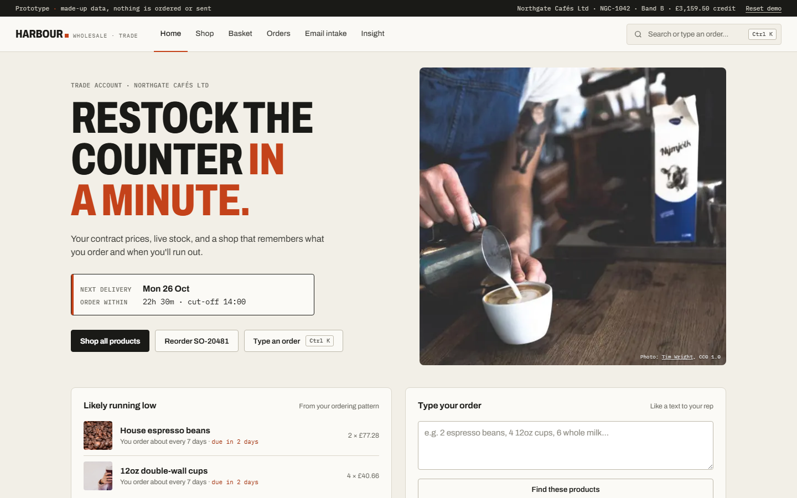
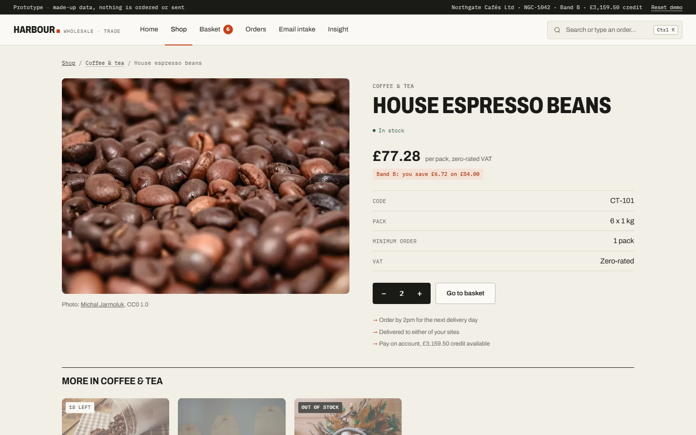
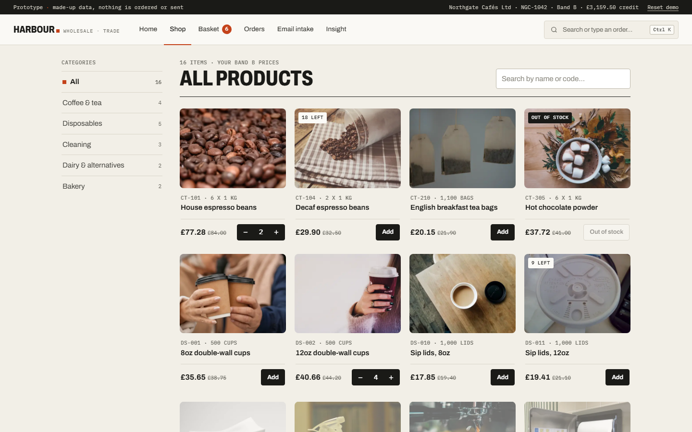
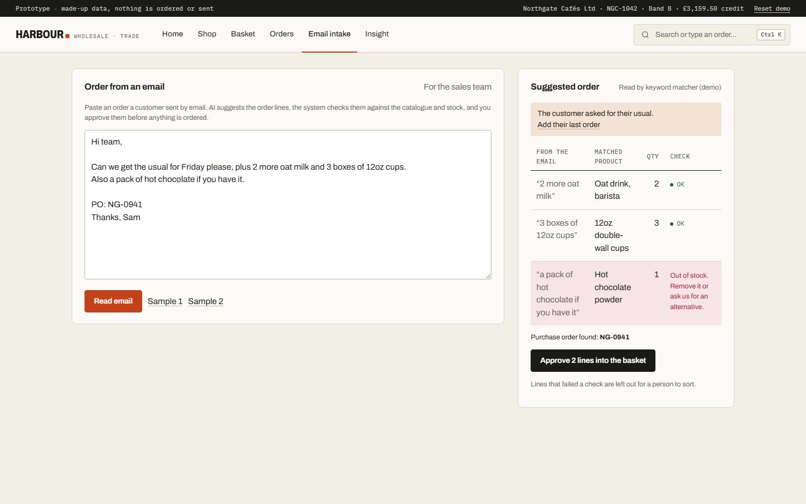
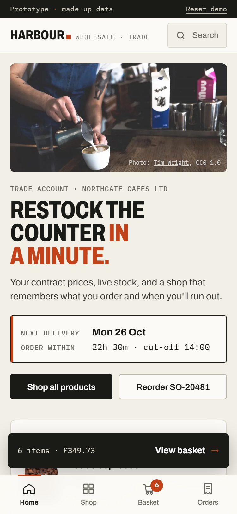
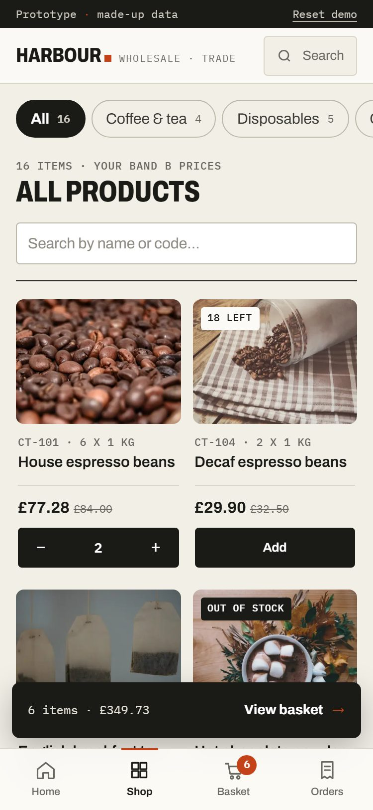

# Trade Reorder Portal

**A B2B ordering portal for a wholesale distributor: customers reorder in a few clicks, and emailed orders are turned into checked order lines with AI instead of being keyed in by hand.**

<p align="center">JavaScript · Node · Claude API · prototype · MIT · <a href="https://latczar.github.io/trade-reorder-portal/">Live demo</a></p>

<p align="center">
  
  
  
  
</p>
<p align="center">
  
  
</p>

## Why it exists

Many distributors still take most orders by email and phone, then key them into the ERP by hand. That is slow, error-prone and hard to grow. The goal here is the one a lot of these businesses set themselves: move most ordering online, and make the orders that still arrive by email cheap to handle.

All data is made up. Nothing is ordered or sent anywhere.

## What it does

- **A proper shop front.** Real product photography, category browsing, search, product pages with the customer's own price, saving and pack details, and related products. Motion is limited to a short reveal when a page opens and is switched off for anyone who prefers reduced motion.
- **Command bar.** Press Ctrl K (or tap search) to find any product, jump to a page, or type a whole order like "2 oat milk, 3 sanitiser" and add it in one go.
- **Live cut-off clock.** A delivery docket on the home page counts down to the 2pm cut-off and shows the delivery date it secures.
- **Smart restock.** Learns how often the customer orders each product and suggests what is likely running low, with one tap to add it all.
- **Type your order.** Customers can type an order the way they'd text their rep ("2 espresso beans, 4 12oz cups") and the shop finds the products.
- **Built for phones.** Bottom tab bar, a basket bar that follows you, quantity steppers, swipeable categories, and tables that turn into cards. Remove and empty-basket actions can be undone.
- **Reorder in a few clicks.** Each customer sees their usual products, their own contract prices and live stock. Any past order can be added to the basket in one click.
- **Checks before it accepts.** Minimum quantities, stock, delivery days and the 2pm cut-off, purchase order numbers and credit limits are all checked, with a plain explanation for anything that blocks an order.
- **Email intake with AI.** The sales team pastes an order email. Claude suggests the order lines, the code checks every suggestion against the catalogue and stock, and a person approves them. Items the model couldn't match, or lines that fail a check, are left out for a person to sort.
- **Reliable ERP sync.** Every order is sent to a mock ERP. If it fails, it retries with a growing delay, then flags the order for a person. You can switch on an outage to watch it happen.
- **Tracks the goal.** The insight page shows how orders arrive (portal, email, phone, rep) against a 90% online target.

## How the AI is kept in check

The model reads the email; it doesn't decide anything.

1. Claude returns structured output (SKU, quantity, the words it came from) validated against a schema.
2. Every suggested line is checked by the same rules as a normal order. Unknown SKUs are rejected.
3. A person approves the lines before they reach the basket, and the order still goes through normal checkout.

The API key stays on the server (`api/parse-order.js`). On a static host with no API, a simple keyword matcher stands in so the demo still works; the page shows which one read the email.

## Run it locally

```bash
npm install
npm test
npm start
```

Then open http://localhost:5173. To use Claude for email intake, deploy to Vercel with `ANTHROPIC_API_KEY` set.

## Project layout

| Path | What it is |
| --- | --- |
| `src/logic.js` | Business rules: pricing, stock and checkout checks, delivery dates. No DOM, fully unit tested |
| `src/intake.js` | Email intake: calls the API, falls back to the keyword matcher, checks suggestions |
| `src/app.js` | The screens and the mock ERP sync |
| `src/images.js` | Product photos (WebP in `assets/`), alt text and credits |
| `api/parse-order.js` | Serverless function that calls Claude with structured output |
| `tests/` | Unit tests for the rules and the intake checks |

## Design

Warm paper background, near-black ink and one signal colour (vermilion) for the things that matter: the cut-off, savings, the active page. Archivo (condensed for headings) is paired with IBM Plex Mono for product codes, prices and labels, so the shop reads like a trade catalogue rather than a template. Images are stored in the repo as WebP at 480 and 960 px and lazy-loaded below the fold.

## Photo credits

Photos are free to use under CC0 or CC BY 2.0, found through [Openverse](https://openverse.org). Each product page also credits its photo.

| Product | Photographer | Licence |
| --- | --- | --- |
| CT-101 | [Michal Jarmoluk](https://stocksnap.io/photo/coffee-beans-PM0QDTADIN) | [CC0 1.0](https://creativecommons.org/publicdomain/zero/1.0/) |
| CT-104 | [Anastasia Zhenina](https://stocksnap.io/photo/coffee-beans-X2HTBSJDKF) | [CC0 1.0](https://creativecommons.org/publicdomain/zero/1.0/) |
| CT-210 | [S Baker](https://www.flickr.com/photos/57373363@N00/67864825) | [CC BY 2.0](https://creativecommons.org/licenses/by/2.0/) |
| CT-305 | [Tohm Brigitte](https://stocksnap.io/photo/hot-chocolate-TKMJJ9D81G) | [CC0 1.0](https://creativecommons.org/publicdomain/zero/1.0/) |
| DS-001 | [Senior Living](https://stocksnap.io/photo/coffee-cup-KBPLPXZBRB) | [CC0 1.0](https://creativecommons.org/publicdomain/zero/1.0/) |
| DS-002 | [Lisa Fotios](https://stocksnap.io/photo/woman-holding-UESXHK58NI) | [CC0 1.0](https://creativecommons.org/publicdomain/zero/1.0/) |
| DS-010 | [Jeffrey Betts](https://stocksnap.io/photo/coffee-cup-VS5KJKKI33) | [CC0 1.0](https://creativecommons.org/publicdomain/zero/1.0/) |
| DS-011 | [renaissancechambara](https://www.flickr.com/photos/39435232@N00/2451804238) | [CC BY 2.0](https://creativecommons.org/licenses/by/2.0/) |
| DS-040 | [準建築人手札網站 Forgemind ArchiMedia](https://www.flickr.com/photos/44343967@N00/10781395574) | [CC BY 2.0](https://creativecommons.org/licenses/by/2.0/) |
| CL-200 | [the.barb](https://www.flickr.com/photos/46439517@N00/402739799) | [CC BY 2.0](https://creativecommons.org/licenses/by/2.0/) |
| CL-210 | [Chevanon](https://stocksnap.io/photo/chocolate-hot-GEBMMDX5VW) | [CC0 1.0](https://creativecommons.org/publicdomain/zero/1.0/) |
| CL-300 | [Mark Turnauckas](https://www.flickr.com/photos/30329962@N08/6009596457) | [CC BY 2.0](https://creativecommons.org/licenses/by/2.0/) |
| DA-001 | [markhillary](https://www.flickr.com/photos/56087830@N00/829573216) | [CC BY 2.0](https://creativecommons.org/licenses/by/2.0/) |
| DA-020 | [AmazingAlmonds](https://www.flickr.com/photos/71430589@N02/8596721996) | [CC BY 2.0](https://creativecommons.org/licenses/by/2.0/) |
| BK-100 | [Olia Gozha](https://stocksnap.io/photo/croissant-bread-8GMCKXR6GE) | [CC0 1.0](https://creativecommons.org/publicdomain/zero/1.0/) |
| BK-120 | [A writer afoot](https://www.flickr.com/photos/60255232@N00/4533917238) | [CC BY 2.0](https://creativecommons.org/licenses/by/2.0/) |
| Home page | [Tim Wright](https://stocksnap.io/photo/coffee-cafe-ICUFSN4V4U) | [CC0 1.0](https://creativecommons.org/publicdomain/zero/1.0/) |

## What a production version would add

Real sign-in per customer and site, the ERP's own API instead of the mock, a proper queue for sync, audit logs on approvals, and monitoring with alerts when syncs fail.
